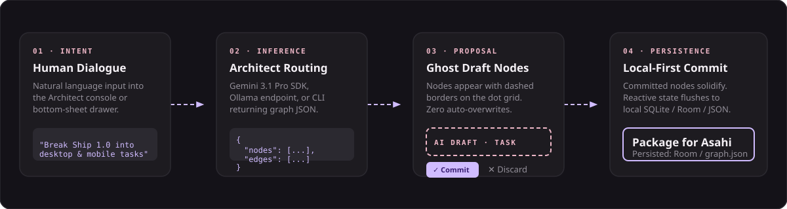
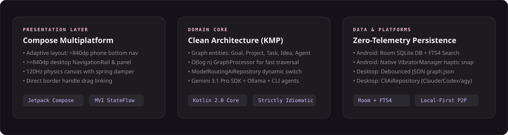

<div align="center">



<p align="center">
  <a href="https://github.com/DaRipper91/OmniMap/releases/latest"></a>
  
  
  
  
  
</p>

### The local-first, AI-writable neural workspace for high-bandwidth thinking.

**Your thoughts as a living graph. An AI Architect proposes mutations; you review and commit.**

</div>

<p align="center">
  <a href="#what-this-is-not">Negative Boundaries</a> •
  <a href="#core-pillars">Core Pillars</a> •
  <a href="#core-capabilities">Capabilities</a> •
  <a href="#how-it-works">How It Works</a> •
  <a href="#system-architecture">Architecture</a> •
  <a href="#packages--distribution">Packages</a> •
  <a href="#developer-quickstart">Developer Setup</a>
</p>


<a id="what-this-is-not"></a>
## 🚫 What This Is NOT

OmniMap deliberately rejects common productivity app tropes:
- **NOT an unchecked autonomous agent:** The AI never silently overwrites, re-links, or deletes your canvas nodes behind your back. Every mutation arrives as a dashed proposal that requires human commitment.
- **NOT a flat Markdown note-taker:** It is not Obsidian, Logseq, or an outline tree with a passive graph viewer bolted onto text files. The node graph is the primary, tactile execution plane.
- **NOT a cloud-tethered whiteboard:** It is not Miro or FigJam. Zero telemetry, zero cloud database dependencies, and zero subscription gates. Your canvas lives in local storage under your complete physical control.



<a id="core-pillars"></a>
## ⚡ Core Pillars

* **⚛️ Tactile Physics Canvas:** Nodes possess mass, velocity, spring-damped elasticity, and edge anchors that dynamically attach to measured card boundaries on a calibrated dot grid. Built natively with Compose Multiplatform for 120Hz smooth panning and zooming.
* **🤖 Proactive Gemini 3.1 Architect:** Dialogues with your graph. When you converse with the Architect, it parses your objectives and generates structured JSON mutation payloads (`{ nodes, edges, message }`) in real time.
* **👻 Explicit Drafting Mode:** AI proposals land on your canvas as dashed rose "ghost cards" linked to existing nodes. You inspect the proposed connections, accept them with a single tap on `Commit`, or wipe them with `Discard`.
* **🔗 Direct Border Handle Linking:** Link any two entities by dragging the interactive handle on a node's border directly onto another card, opening the typed relationship selector (`relates_to`, `depends_on`, `subtask_of`, `leads_to`).
* **🔒 Sovereign Local-First Storage:** Android runs a local SQLite Room database with FTS4 full-text search indexing. Desktop persists state via debounced, atomic JSON writes to `$XDG_DATA_HOME/omnimap/graph.json`.
* **🎛️ Hybrid Intelligence Routing:** Out-of-the-box routing across Google Gemini 3.1 Pro (official KMP SDK), local Ollama instances, OpenAI-compatible APIs, and local Agent CLIs (`cli:claude`, `cli:codex`, `cli:copilot`, `cli:antigravity`).


<a id="core-capabilities"></a>
## 🛠️ Core Capabilities


### 1. The Five Typed Canvas Entities

OmniMap models knowledge through five strict domain types, each with its own semantic color token, geometry, and priority:

| Entity | Symbol | Color Token | Semantic Role |
| :--- | :---: | :--- | :--- |
| **`GOAL`** | ◯ Ring | Sky Blue (`#9ECAFF`) | High-level objectives and North Star deliverables. |
| **`PROJECT`** | ▢ Box | Lavender (`#D0BCFF`) | Specific initiatives and operational code repositories. |
| **`TASK`** | ■ Solid | Mint Green (`#7FD8C4`) | Concrete work units and actionable items. |
| **`IDEA`** | ◇ Diamond | Amber (`#F6C86A`) | Uncommitted insights, thoughts, and architectural possibilities. |
| **`AGENT`** | ⬡ Hexagon | Rose (`#EFB8C8`) | Active AI processes, reasoning personae, and automated actors. |

### 2. Adaptive Multiplatform Workspace

The interface dynamically reconfigures its layout at the `840dp` breakpoint:
- **Mobile (< 840dp, e.g. Pixel 10 Pro):** Bottom `NavigationBar` for rapid thumb access, full-screen touch canvas, and Architect interaction via a gesture-driven bottom-sheet modal.
- **Desktop (≥ 840dp, Linux / macOS / Windows):** Slim `NavigationRail`, keyboard navigation shortcuts, and a permanent collapsible 380dp Architect side panel with live Commit/Discard controls anchored above the chat thread.


<a id="how-it-works"></a>
## 🔄 How It Works


<p align="center">
  
</p>

1. **Dialogue Intent:** You enter a directive into the Architect console (e.g. *"Break down the Asahi Linux packaging sprint into tasks and link them to the Desktop project"*).
2. **Structured Inference:** `ModelRoutingAiRepository` dispatches the prompt alongside canvas context to the active engine (Gemini 3.1 Pro, local Ollama, or CLI agent). The engine streams back a validated JSON mutation payload:
   ```json
   {
     "message": "Generated 3 deployment tasks linked to Project Desktop",
     "nodes": [
       { "id": "task_asahi", "type": "TASK", "title": "Package Asahi ARM64 RPM", "x": 620, "y": 340 }
     ],
     "edges": [
       { "sourceId": "proj_desktop", "targetId": "task_asahi", "type": "DEPENDS_ON" }
     ]
   }
   ```
3. **Ghost Proposal:** `GraphViewModel` parses the payload via `Gson` and injects ghost nodes into the canvas with dashed rose borders and animated connection stubs.
4. **Human Verification & Commit:** You review the layout, reposition nodes if desired, and hit `✓ Commit`. The state solidifies into permanent lavender cards and flushes reactively to disk.


<a id="system-architecture"></a>
## 🏛️ System Architecture


<p align="center">
  
</p>

### Why It's Built This Way: Key Architectural Decisions

* **Display-Independent Coordinates (`dp`):**
  * *Failure that motivated it:* Early builds stored node coordinates in raw pixels. On high-density displays (such as 2× scale Linux laptops), node cards scaled up while positions remained constant, causing cards to pile into an unusable overlapping mess.
  * *The invariant:* All `Node.x` and `Node.y` values are strictly stored in `dp` (display-independent points). A one-time automated migration converts legacy database records (Desktop `graph.json` v1 → v2, Android Room v3 → v4) upon opening.
* **Dynamic Card-Border Edge Anchoring:**
  * *Failure that motivated it:* Fixed-offset line rendering drew edges to guessed points (100px right, 40px down), causing arrows to terminate inside cards or vanish behind backgrounds.
  * *The invariant:* `CanvasState` hoists measured card dimensions; `EdgeComposable` calculates the exact intersection point with the target card's outer perimeter, rendering clean arrowheads regardless of zoom level or card text length.
* **Zero Heavy Dependency Injection:**
  * No Hilt, Dagger, or Koin reflection overhead. The multiplatform container tree uses pure manual dependency injection (`AppContainer` on Android, `DesktopAppContainer` on JVM), ensuring sub-second cold starts and zero runtime magic.


<a id="packages--distribution"></a>
## 📦 Packages & Distribution


Precompiled standalone binaries for [OmniMap v1.0 (Build 6)](https://github.com/DaRipper91/OmniMap/releases/tag/v1.0-b6):

| Platform | Target Architecture | Package Format | Download |
| :--- | :--- | :--- | :--- |
| **Android** | ARM64 / ARMv7 (minSdk 26) | `.apk` (Debug) | [`androidApp-debug.apk`](https://github.com/DaRipper91/OmniMap/releases/download/v1.0-b6/androidApp-debug.apk) |
| **Fedora / Asahi** | Apple Silicon (`aarch64`) | `.rpm` Native Package | [`omnimap-1.0.0-1.aarch64.rpm`](https://github.com/DaRipper91/OmniMap/releases/download/v1.0-b6/omnimap-1.0.0-1.aarch64.rpm) |
| **Fedora / RHEL** | x86_64 Desktop | `.rpm` Native Package | [`omnimap-1.0.0-1.x86_64.rpm`](https://github.com/DaRipper91/OmniMap/releases/download/v1.0-b6/omnimap-1.0.0-1.x86_64.rpm) |
| **Arch / CachyOS** | x86_64 / aarch64 | Self-Contained Tarball | [`omnimap-1.0.0-linux-x86_64.tar.gz`](https://github.com/DaRipper91/OmniMap/releases/download/v1.0-b6/omnimap-1.0.0-linux-x86_64.tar.gz) |
| **Debian / Ubuntu** | x86_64 / AMD64 | `.deb` Native Package | [`omnimap_1.0.0_amd64.deb`](https://github.com/DaRipper91/OmniMap/releases/download/v1.0-b6/omnimap_1.0.0_amd64.deb) |
| **Windows** | Windows 10 / 11 (x86_64) | `.msi` Windows Installer | [`OmniMap-1.0.0.msi`](https://github.com/DaRipper91/OmniMap/releases/download/v1.0-b6/OmniMap-1.0.0.msi) |
| **macOS** | Apple Silicon & Intel | `.dmg` Disk Image | [`OmniMap-1.0.0.dmg`](https://github.com/DaRipper91/OmniMap/releases/download/v1.0-b6/OmniMap-1.0.0.dmg) |


<a id="developer-quickstart"></a>
## 💻 Developer Quickstart

### Prerequisites
- JDK 17 or JDK 21
- Android SDK (for `:androidApp`)
- Git

### Build & Run Commands

```bash
# Clone the repository
git clone https://github.com/DaRipper91/OmniMap.git && cd OmniMap

# Run the Desktop Application (JVM)
./gradlew :desktop:run

# Build Android Debug APK
./gradlew :androidApp:app:assembleDebug

# Package Desktop distributable for host OS (RPM/DEB/MSI/DMG)
./gradlew :desktop:package

# Package self-contained Linux tarball (Arch/CachyOS/any distro)
./gradlew :desktop:packageLinuxTarball

# Compile shared Kotlin Multiplatform core
./gradlew :shared:compileKotlinDesktop :shared:compileKotlinAndroid
```

### Canvas Keyboard Shortcuts (Desktop)

| Keybinding | Action |
| :--- | :--- |
| `N` | Create new node at pointer location |
| `L` | Open link manager for selected node |
| `E` / `Enter` | Edit selected node title and content |
| `Delete` / `Backspace` | Delete selected node and attached edges |
| `F` / `Ctrl+0` / `Cmd+0` | Fit and center all nodes to screen |
| `Ctrl+=` / `Ctrl+-` | Zoom in / out toward canvas center |
| `Esc` | Deselect active node |


## ⚖️ License & Verification

* **License:** Licensed under the MIT License.
* **Asset Toolchain:** All vector assets and diagrams in `docs/assets/` are deterministic and reproducible. Rebuild anytime via:
  ```bash
  bash docs/assets/src/build.sh
  ```
